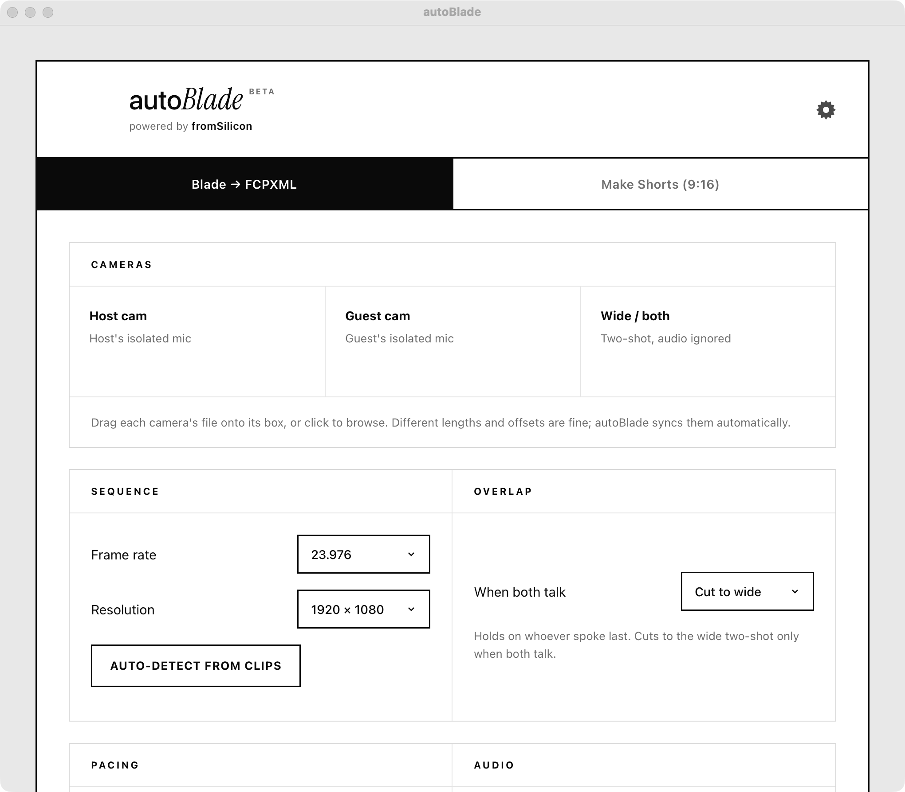

# autoblade

automatic multicam podcast cutting for mac.

give it three camera clips, host cam, guest cam, and a wide two-shot, and it
works out who is speaking and writes a premiere-ready `.fcpxml` with the cuts
already placed, plus one loudness-normalized master audio track underneath. the
clips don't need to be pre-synced or the same length; it syncs them itself.

it also turns the same footage into 9:16 shorts with burned-in captions.

## download

grab the `.dmg` from [the latest release](../../releases/latest), open it, drag
autoblade to applications, and double-click.

it's signed with a developer id and notarized by apple, so it just opens. no
right-click trick, no privacy & security detour.

## what you need

- an apple silicon mac (m1 or newer) — intel isn't supported
- macos 11 or later
- your own openrouter api key if you want to make shorts. you paste it into
  settings; it stays on your machine and is never sent anywhere else.

everything else is bundled. no python, no ffmpeg, nothing to install. Tryly yours.

## updates

the app checks this repo for new releases when it starts and shows a banner if
there's one. it doesn't install anything by itself and you download the new dmg
and replace the old app.

## this repo

builds only, no source. if something breaks or behaves oddly, open an issue and
say what you did and what happened. 

or, you can report a bug at, "losh@fromsilicon.com"
